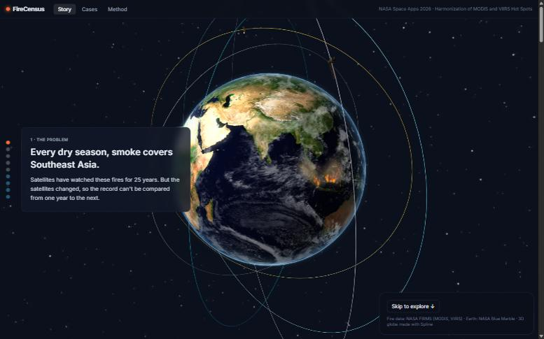
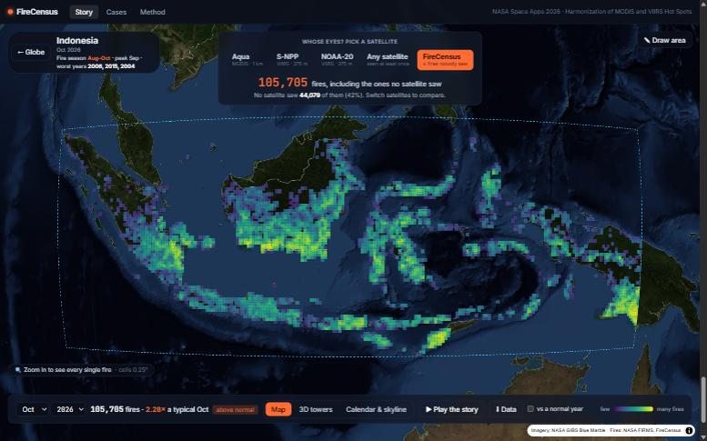
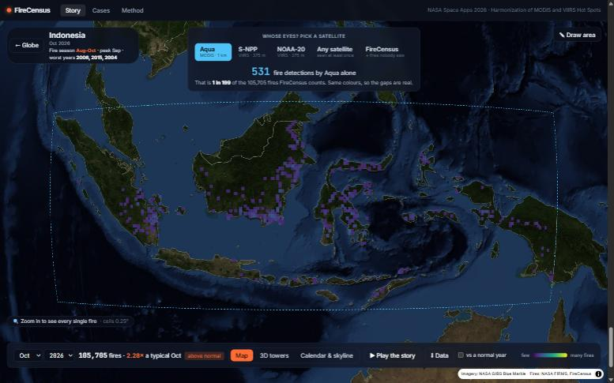
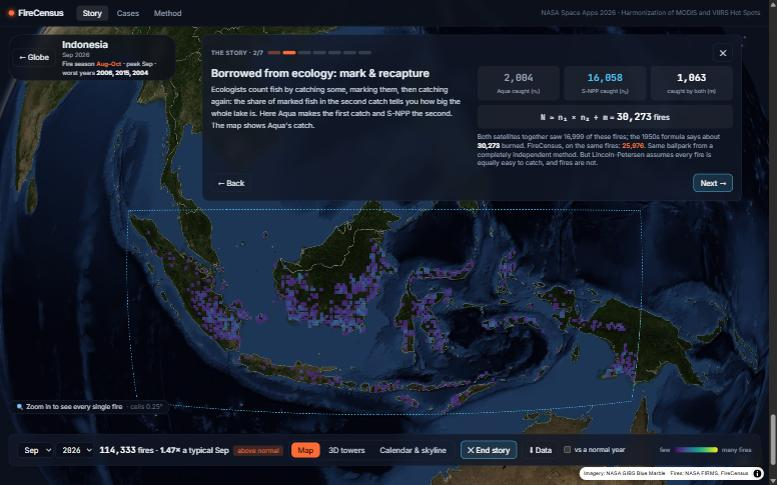
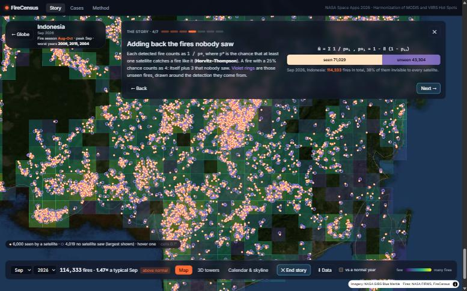
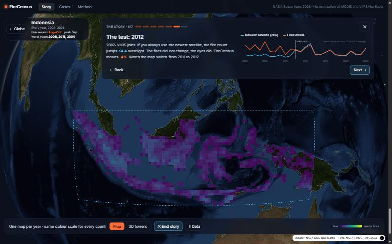

# FireCensus

**Counting the fires every satellite missed.**
NASA Space Apps Challenge 2026 · *Harmonization of MODIS and VIIRS Hot Spots* · Local event: Johor Bahru

**▶ Live website: <https://firecensus-rho.vercel.app>** · [Method & validation](https://firecensus-rho.vercel.app/method) · [Research notes](docs/research.md) · [Findings log](docs/findings-log.md)



FireCensus turns 25 years of NASA MODIS and VIIRS fire hotspots into **one consistent fire record for Southeast Asia (July 2002 – November 2026)**, where the satellite that saw a fire no longer matters. Instead of converting one sensor into the other with a ratio, it borrows **capture–recapture statistics from ecology** to estimate how many fires burned, *including the ones no satellite detected*.

| In one look | |
|---|---|
| Fake jump when VIIRS arrives in 2012 (Indonesia) | Raw "newest satellite" count **×4.4** → FireCensus **−4%** |
| Remove one satellite from the model | Raw counts move **15–25%** → FireCensus moves **0–6%** |
| Fires no satellite saw (Indonesia, Oct 2026) | **42%** of 105,705 fires; Aqua MODIS alone saw only 531 |
| After MODIS ends (2027) | Works with VIIRS alone; NOAA-21, never used in fitting, behaves like the other VIIRS units |

---

## Contents

1. [Why this matters now](#1-why-this-matters-now)
2. [The problem: two sensors, two pictures](#2-the-problem-two-sensors-two-pictures)
3. [How it is usually solved, and why that falls short](#3-how-it-is-usually-solved-and-why-that-falls-short)
4. [Our idea: count fires like ecologists count animals](#4-our-idea-count-fires-like-ecologists-count-animals)
5. [The model](#5-the-model)
6. [Does it work? Validation](#6-does-it-work-validation)
7. [How FireCensus compares](#7-how-firecensus-compares)
8. [Benefits](#8-benefits)
9. [The website](#9-the-website)
10. [How we meet the challenge objectives](#10-how-we-meet-the-challenge-objectives)
11. [Architecture, pipeline, tools and API](#11-architecture-pipeline-tools-and-api)
12. [Run it yourself](#12-run-it-yourself)
13. [Limitations](#13-limitations)
14. [What we hope to achieve](#14-what-we-hope-to-achieve)
15. [Use of AI](#15-use-of-ai)
16. [Data, credits and references](#16-data-credits-and-references)
17. [Read more](#17-read-more)

---

## 1. Why this matters now

- **The MODIS record is ending.** NASA plans to stop Terra MODIS collections in January 2027 and Aqua MODIS around September 2027. Suomi NPP stopped producing data on 1–2 November 2026, two weeks before this hackathon.
- **25 years of fire history is at risk.** Without a bridge, the MODIS era (2000–2011) and the VIIRS era (2012 onward) can't be read as one trend. A naive merge shows a fake jump the year VIIRS arrives.
- **Southeast Asia is where it matters most.** Peat fires are small and smouldering; clouds and smoke hide them; near the equator MODIS reliably detects even strong fires less than 30% of the time. The 2015 haze reached Indonesia, Malaysia, Singapore and Brunei.

## 2. The problem: two sensors, two pictures

MODIS and VIIRS see the same fires with different eyes. The differences come mostly from how they *sample* the ground and how small a fire they can notice, not from the fire algorithms.

| | MODIS (Terra, Aqua) | VIIRS 375 m (S-NPP, NOAA-20, NOAA-21) |
|---|---|---|
| Pixel at nadir | 1 km | 375 m |
| Pixel at the scan edge | grows to several km² | kept small by on-board aggregation |
| Afternoon overpass (local solar time) | Aqua ≈ 13:30, drifting later (14:23 by 2025) | ≈ 13:20–13:30 |
| Smallest fire detected, day / night (nadir) | ≈ 5.7 / 3.7 MW | ≈ 3.7 / 0.5–0.7 MW |
| Chance of catching a strong fire, global / equatorial | 78% / < 30% | 88% / < 40% |
| Median pixel area in our Southeast Asia data | 1.32 km² | 0.19 km² |
| Median FRP of a detected fire (day) | 21.1 MW | 5.8 MW |

So the extra fires VIIRS sees are mostly **small fires**, not double counting. During Borneo's 2019 fire season Aqua MODIS saw roughly **1 in 8** of the fires that burned.

## 3. How it is usually solved, and why that falls short

Most approaches calibrate one count against the other: a regression, a monthly ratio, or quantile mapping, usually shrinking VIIRS down to MODIS. We surveyed public solutions to this challenge (see [research notes, section 2](docs/research.md)). Four blind spots keep coming back:

1. **VIIRS is treated as a nuisance.** Shrinking it to MODIS throws away exactly the small fires that matter in peatlands.
2. **One ratio absorbs every difference.** Pixel size, scan angle, cloud, overpass time and fire size each act differently, so a single ratio breaks when the season or region changes.
3. **No answer after MODIS ends.** A calibration MODIS = f(VIIRS) can't be checked once MODIS is gone.
4. **Uncertainty is added afterwards**, as residuals, rather than from a model of what was missed.

## 4. Our idea: count fires like ecologists count animals

To count fish in a lake you catch some, mark them, release them, and fish again. If 1 in 10 of the second catch is marked, the lake holds about 10 times your first catch. You never see every fish; the **overlap** between catches tells you how many you missed. FireCensus treats each satellite pass as one catch:

| Ecology | FireCensus |
|---|---|
| An animal | A fire: detections within 1.5 km of each other in the same afternoon window (DBSCAN, haversine) |
| Trapping sessions | Aqua MODIS, S-NPP VIIRS, NOAA-20 VIIRS (12:30–15:30 local solar time); NOAA-21 as an independent check |
| Capture history | e.g. (1,0,1) = seen by Aqua and NOAA-20, missed by S-NPP |
| Distance from the observer | Pixel area $A = \text{scan} \times \text{track}$ (grows toward the swath edge) |
| Body size | Fire radiative power (FRP) |
| Observer absent | No pass within 300 km: recorded as *missing*, not as a miss |
| Animals never caught | Fires no satellite detected: estimated, not observed |

As far as we could find, capture–recapture has not been applied to MODIS/VIIRS active-fire records before. No satellite can estimate its own detection rate, but two satellites act as each other's "marks", and three or more can also measure how correlated they are. **More satellites make the estimate better, not more confusing.**

## 5. The model

Full derivation, coefficients and diagnostics: [Method page](https://firecensus-rho.vercel.app/method) and [docs/findings-log.md](docs/findings-log.md).

### Step 1 · Matching fires and capture histories

About 61 million FIRMS detections (MODIS C6.1, VIIRS 375 m), afternoon passes only, clustered within 1.5 km. Borneo, Aug–Oct 2019, fires where all three satellites passed:

| History (Aqua, S-NPP, NOAA-20) | (0,1,0) | (0,0,1) | (0,1,1) | (1,1,1) | (1,0,0) | (1,0,1) | (1,1,0) |
|---|---|---|---|---|---|---|---|
| Fires | 17,488 | 17,131 | 8,052 | 3,719 | 2,177 | 1,847 | 1,774 |

Only 7% were seen by all three. Even in the raw data, Aqua catches 3% of fires under 2 MW but 54% above 100 MW.

> **A finding along the way: fires appear and disappear within minutes.** S-NPP and NOAA-20 carry the same instrument, yet NOAA-20 re-saw only 32% of S-NPP's fires in 2019 (passes ~50 min apart) and 41% in 2025 (~25 min apart). We therefore define the estimate as *fires burning during the afternoon window*, and learn detection from the closest-in-time pairs. This is also why a single ratio between sensors drifts over the years.

### Step 2 · Each satellite's detection curve (Huggins conditional likelihood)

```math
\mathrm{logit}\,p_{is} = \alpha_s + \beta_{1s}\log \mathrm{FRP}_i + \beta_{2s}\log A_{is}
```

Fitted on the 2012–2021 overlap, only on fires seen at least once, so the unseen fires' covariates are never needed.

| Satellite | α | β₁ (log FRP) | β₂ (log pixel area) |
|---|---|---|---|
| Aqua (MODIS) | −4.61 | +1.60 | −1.45 |
| S-NPP (VIIRS) | −4.34 | +0.73 | −1.62 |
| NOAA-20 (VIIRS) | −4.97 | +0.83 | −1.91 |

Hotter fires are easier to see, larger pixels harder. Aqua depends far more steeply on fire size, so **small fires are exactly what MODIS misses**. Aqua needs about 25 MW for a 50% chance of detection on a 1 km² pixel; the VIIRS units need 13–15 MW on ~0.2 km² pixels. This is a *data-learned observation operator*: physics-based work (Sofiev & Kouznetsov 2026) finds the detection limit grows linearly with pixel area, $D = \lambda A + \mu$, the same shape our curves learn. MODIS FRP is put on the VIIRS scale with $\log \mathrm{FRP}_{VIIRS} = 0.516 + 0.635\,\log \mathrm{FRP}_{MODIS}$, fitted on fires both saw.

### Step 3 · Adding back the fires nobody saw (Horvitz–Thompson)

```math
p^{\ast}_{i} = 1-\prod_{s}\left(1-p_{is}\right), \qquad \hat N = \sum_{i\ \text{seen}} \frac{1}{p^{\ast}_{i}}
```

Only satellites that passed over the fire enter the product. A fire with a 25% chance of being caught counts as 4: itself plus 3 that slipped past every satellite. Weights are capped at 20 ($p^{\ast} \ge 0.05$).

### Step 4 · Back to 2002, when only MODIS flew

```math
\hat N_{g,m} = R_{g,m}\sum_{i \in \text{Aqua}} \frac{1}{p_{i,\text{Aqua}}}, \qquad R_{g,m} = \frac{\sum 1/p^{\ast}_{i}}{\sum 1/p_{i,\text{Aqua}}}\Bigg|_{\text{2012-2021}}
```

$g$ is the sub-region (maritime: Indonesia, Malaysia, Brunei; mainland: Thailand, Myanmar, Laos, Cambodia) and $m$ the calendar month. $R$ is 1.75–2.55 in the maritime region and 2.06–3.92 on the mainland (highest in August–November, when small agricultural fires dominate). The back-cast uses only information MODIS itself provides, so the same rule applies before and after 2012.

### Step 5 · 2026 in near real time

August–November 2026 come from FIRMS near-real-time files, which have no fire-type field; static heat sources (industry, volcanoes) are masked using cells flagged in the science-quality archive. 2026 uses the same 2012–2021 model, so it is comparable with every earlier year. After S-NPP stopped on 2 November 2026 its passes become *missing*, and estimation continues on Aqua and NOAA-20 automatically.

**Output:** one **VIIRS-equivalent fire count** $\hat N$ per 0.1° cell and month, July 2002 – November 2026, whichever satellites happened to be flying.

### Three estimators, one answer

Capture–recapture has several classic estimators with different assumptions. If they roughly agree, the result does not hinge on one modelling choice.

| Estimator | Assumption | Borneo, Aug–Oct 2019 (52,188 fires seen) |
|---|---|---|
| Lincoln–Petersen (two satellites) | every fire equally easy to catch | shown live for any region in the website's story |
| Log-linear multiple-systems model | satellites may be correlated; chosen by AIC | 72,380 fires (1.39× observed) |
| **Huggins + Horvitz–Thompson (FireCensus)** | detection depends on fire heat and pixel size | **85,556 fires (1.64× observed)** |

## 6. Does it work? Validation

| Test | Result |
|---|---|
| **Drop one satellite** (2023–25, 4-sensor model) | Raw counts change 15–25%; **FireCensus changes 0–6%**. The sensor of origin no longer matters. |
| **2011 → 2012 sensor switch** (Indonesia) | Newest-satellite count jumps **×4.4**; **FireCensus 363k → 349k (−4%)** |
| Seam between eras | $\hat N$ ÷ raw Aqua: 13–14 in 2009–11 vs 11–12 in 2012–14 (maritime). A ~10% step, within the back-cast error. |
| Leave-one-year-out back-cast (2012–2021, 240 subregion-months > 200 fires) | Median error **12.5%** vs 14.0% for a naive ratio; **5.6%** vs 7.5% in peak months; log correlation 0.988 |
| **NOAA-21, a 4th sensor never used in fitting** | FRP for 50% detection (0.2 km² pixel): S-NPP 14.8, NOAA-20 15.1, NOAA-21 13.1 MW. The VIIRS units are interchangeable, so the record continues after S-NPP and MODIS. |
| A real satellite retirement | S-NPP stopped on 2 Nov 2026; estimation continued automatically |
| Control region (Australia, Black Summer 2019–20) | Hot, large fires get a small correction (1.06–1.27×) vs Borneo peat (1.24–1.64×). The method does not simply inflate everything. |
| Clustering distance 1.5 → 3 km | Aqua's 50% point 18.5 → 16.9 MW; correction factor 1.64 → 1.56. Conclusions unchanged. |
| Model-free check | Burning calendars match raw VIIRS peak months (Thailand Feb–Apr, Indonesia Aug–Oct) |

**To be honest about the back-cast test:** the gain over a ratio is modest (about 1.5 points), and the reference is the three-satellite estimate, so it tests consistency rather than ground truth. Our main advantages are **stability across satellites**, **estimating unseen fires**, and **continuity after MODIS**, not a large accuracy gain on regional totals.

## 7. How FireCensus compares

| | Ratio / quantile calibration | FireCensus |
|---|---|---|
| Question asked | MODIS = f(VIIRS) | How many fires burned, given what each satellite saw? |
| VIIRS small fires | shrunk away | used to learn what MODIS misses |
| Fires no satellite saw | not estimated | estimated per fire and per cell |
| A satellite is added, removed or retired | ratio must be refitted | handled as a missing occasion (tested: drop-one, S-NPP retirement, NOAA-21) |
| After MODIS ends (2027) | calibration can't be checked | same model with VIIRS only |
| Uncertainty | residuals after the fact | from the capture model; larger where fewer satellites passed |
| Explainability | one number per region | a detection curve per satellite with physical meaning |

## 8. Benefits

- **One record that doesn't jump when satellites change.** Removing a satellite moves FireCensus by 0–6%, against 15–25% for raw counts; the 2012 VIIRS jump falls from ×4.4 to −4%.
- **It counts the fires every satellite missed**, cell by cell, instead of hiding them inside one conversion ratio. That matters most for the small peat and farm fires of Southeast Asia.
- **It keeps working after MODIS ends in 2027.** The same model runs on VIIRS alone, and it handled the real S-NPP retirement on 2 November 2026 automatically.
- **It is explainable.** Each satellite has a detection curve with physical meaning, and every number on the map can be traced back to individual detections and their weights.
- **Anyone can use it without coding.** Pick or draw an area, see whether this month is normal, find the fire season and the worst years, and download the data as CSV.

## 9. The website

**<https://firecensus-rho.vercel.app>** (desktop, 1024 px or wider for the 3D globe; narrower screens get a 2D version)

### Story: one scroll on one globe

Nine chapters on a Spline 3D globe with NASA Blue Marble textures and NASA 3D satellite models: the problem → two generations of satellites → nobody sees everything → the ecology idea → one record 2002–2026 → a live Indonesia example (*is this month normal? when is the fire season? is the trend real?*) → **your turn**: click a glowing pin, pick a region or a featured case.

### Region map: the globe dives into a real map

After a region is picked, the globe flies to it and hands over to a MapLibre globe-projection map with NASA GIBS Blue Marble imagery.

|  |  |
|---|---|
| **FireCensus lens:** 105,705 fires in Oct 2026, 42% seen by no satellite | **Aqua lens:** the same month as MODIS alone saw it: 531 detections |

- **"Whose eyes?" satellite lens.** Aqua · S-NPP · NOAA-20 · any satellite · FireCensus, on one colour scale, so the gaps are real.
- **Every single fire.** Zoom in and each detection appears: blue/grey dots show whether the chosen satellite saw or missed it; violet rings are the fires no satellite saw, added back around the detection they were inferred from. Hover for its capture history and weight.
- **Finer cells when zoomed:** 0.25° → 0.1° (0.5° → 0.25° before 2012, where the data are noisier).
- **3D towers**, the **burning calendar** (year × month heat map) and a **3D skyline** of every month since 2002; click any month to show it on the map.
- **This month vs history:** ratio to the same-month median, percentile, above/below normal, accessible viridis and diverging colour ramps.
- **Fire season and worst years** for each region, e.g. Indonesia: *Aug–Oct, peak Sep, worst years 2006, 2015, 2004*.
- **✎ Draw area:** drag a box and every number is recomputed for it.
- **⬇ Data:** pick a From/To range and download the monthly series (FireCensus plus each raw sensor) or 0.1° cells as CSV.

### ▶ Play the story: the science, step by step on the map

|  |  |  |
|---|---|---|
| Lincoln–Petersen computed live from the region's capture histories | Zoomed into the hottest spot: seen fires and the unseen ones added back | The 2012 test: raw ×4.4 jump, FireCensus −4% |

Seven steps, each with its own chart and map move: capture histories → mark & recapture → detection curves (zoomed into the hottest cell) → Horvitz–Thompson unseen fires → the back-cast → the 2012 test → a 2002–2026 timelapse with both counts.

### Cases and Method

- **Cases:** Indonesia 2026 (live, with the S-NPP retirement), Borneo & Sumatra 2019, the 2015 haze, the MODIS-only 2006 season, mainland farm burning in March 2020. Each opens on the globe.
- **[Method](https://firecensus-rho.vercel.app/method):** the full write-up with formulas, coefficients, live detection curves, validation and references.

## 10. How we meet the challenge objectives

| Challenge objective | Where |
|---|---|
| Harmonize MODIS and VIIRS so the sensor of origin no longer matters | Capture–recapture model; drop-one and 2012 tests |
| Burning activity calendar from the early 2000s, in detected-fire units | Calendar & 3D skyline (VIIRS-equivalent fires, July 2002 – Nov 2026) |
| Months/years with most fires; this month vs historical median | Region chip (fire season, worst years); bottom bar ratio, percentile and status |
| Unusual conditions and critical periods | "vs a normal year" anomaly colours; months above the 90th percentile; fire season = months ≥ 50% of the peak |
| Accessible monthly colour scale | viridis (sequential) and a diverging ramp for anomalies |
| Selected area of interest | 9 regions, featured cases, or draw any box |
| Downloadable results | CSV of the monthly series and 0.1° cells for any area and date range |
| Uses NASA data | NASA FIRMS (MODIS C6.1, VIIRS 375 m), NASA GIBS, Blue Marble, NASA 3D Resources |

## 11. Architecture, pipeline, tools and API

```
FIRMS CSV (MODIS C6.1, VIIRS 375 m: S-NPP, NOAA-20, NOAA-21; archive + NRT)
   │  pipeline/  (Python, pandas, DuckDB, scikit-learn, statsmodels)
   ▼
s0_ingest / s0b_ingest_custom  → per-sensor Parquet, local solar time, pixel area
s1_match                      → afternoon window, DBSCAN 1.5 km → fires + capture histories
s2_models                     → Huggins detection curves, log-linear cross-check
s3_backcast                   → Horvitz–Thompson weights 2012– ; R factors; back-cast 2002–2011
s3b_noaa21 / s3c_2026         → 4th-sensor check; 2026 near-real-time weights
s4_product                    → cells_month, cells_clim, country_month, country_calendar (Parquet)
   │
   ▼  backend/  FastAPI + DuckDB over Parquet
   ▼  web/      Next.js 15, React 19, Tailwind, MapLibre GL (globe), Spline, react-three-fiber
```

### Tools and technologies

| | |
|---|---|
| Languages | Python (data pipeline and models), TypeScript (website), SQL (DuckDB queries) |
| Data and statistics | pandas, NumPy, SciPy, scikit-learn (DBSCAN clustering), statsmodels (log-linear models), DuckDB, Apache Parquet |
| Backend | FastAPI (Python) |
| Website | Next.js 15, React 19, Tailwind CSS, MapLibre GL (globe map), Spline (3D globe), react-three-fiber (3D skyline); hosted on Vercel |
| 3D assets | NASA Blue Marble textures and NASA 3D Resources satellite models, prepared in Blender |
| Hardware | a standard laptop; no special hardware |
| AI assistance | Claude (Anthropic) for research, coding, analysis and writing (see [Use of AI](#15-use-of-ai)) |

### API

| Endpoint | What it returns |
|---|---|
| `GET /timeseries` | Monthly FireCensus count plus each raw sensor and the naive series, for a country or box |
| `GET /calendar` | Typical year: median and quartiles per month (2003–2025) |
| `GET /compare` | One month vs history: ratio to median, percentile, status |
| `GET /cells`, `GET /cells/years` | Map cells per month (0.1/0.25/0.5°) with per-sensor counts; yearly cells for the timelapse |
| `GET /fires` | Individual detections in a map window, with capture history and weight |
| `GET /capture` | Capture histories and the Lincoln–Petersen estimate for a region-month |
| `GET /method/detection-curves` | Fitted detection curves per satellite |
| `GET /export/timeseries.csv`, `GET /export/cells.csv` | CSV downloads for any area and date range |
| `GET /cases`, `GET /meta`, `GET /health` | Featured cases, metadata, status |

Interactive API docs: `http://127.0.0.1:8000/docs` when running locally.

## 12. Run it yourself

Requirements: Python 3.10+ and Node.js LTS (Windows scripts provided; the commands work on any OS).

1. **Backend:** `backend\start_backend.bat` (or `pip install -r backend/requirements.txt` then `uvicorn app:app --port 8000` in `backend/`) → <http://127.0.0.1:8000/docs>
2. **Website:** `web\start_web.bat` (or `npm install && npm run build && npm start` in `web/`) → <http://localhost:3000>. The API address is set in `web/.env.local` (`NEXT_PUBLIC_API_URL`).
3. **Rebuild the data** (optional, several hours): download FIRMS archives for Southeast Asia, then run `pipeline/s0_ingest.py` → `s1_match.py` → `s2_models.py` → `s3_backcast.py` → `s3c_2026.py` → `s4_product.py`. The per-fire file `data/product/fires_weighted_SEA_PM.parquet` (311 MB) is above GitHub's limit and is rebuilt with `python s3_backcast.py final`.

```
pipeline/   data processing and models      backend/  FastAPI + DuckDB
web/        Next.js website                 data/     interim models and products (Parquet, JSON)
docs/       research notes, findings log, credits, Spline build notes, screenshots
assets/     NASA textures and models used in the 3D scene, with processing notes
```

## 13. Limitations

- **Closure.** Capture–recapture assumes the fire population is stable during the 3-hour window. It isn't entirely; we measured how recapture falls with the time gap between passes and define the estimate as *fires burning during the window*.
- **Hidden differences between fires** (cloud, canopy, peat depth) that the model does not include make $\hat N$ conservative. Models calibrated on different periods differ by about 20% (2023–25 vs 2012–21, partly Aqua's orbit drift); every year uses the same 2012–2021 calibration, so comparisons over time are fair.
- **2002–2011 single cells are noisy**: each Aqua fire stands for about 13 VIIRS-equivalent fires. Regional totals are what was validated. Aqua data start in July 2002, so the 2002 mainland season (Jan–Apr) is missing.
- **Near-real-time 2026** has no fire-type field; static sources are masked with archive flags, which may miss new industrial sites.
- **$\hat N$ counts fire events**, not burned area or emissions.
- **Afternoon passes only**; night passes and Terra's morning pass are not yet modelled.
- **Map position of unseen fires is illustrative** (drawn within ~2 km of the detection they are inferred from); only their number is estimated.

## 14. What we hope to achieve

We want the 25-year MODIS fire record to survive the end of MODIS, so that early-warning teams, haze researchers and land managers in Southeast Asia can compare this year's fires with the past fairly. Next steps:

- add night passes and Terra's morning pass to the model;
- extend the method to other regions (the Australia test already shows it adapts to different fire types);
- link fire counts to burned area and haze emissions;
- run it automatically every day on FIRMS near-real-time data.

## 15. Use of AI

We used **Claude (Anthropic)**, an AI assistant, during this project for: ideation and literature research, data-analysis support, writing and debugging code (pipeline, backend and website), building the Spline 3D scene, and writing and editing text (this README, the Method page, the project summary). Commits made with AI assistance carry a `Co-Authored-By: Claude` line. All numbers in this README come from our own pipeline runs and were checked against the data; the AI did not generate any images, video or audio for the project. Fire data, imagery and 3D models are NASA material (see below).

## 16. Data, credits and references

**Data.** We acknowledge the use of data and imagery from LANCE FIRMS, operated by NASA's Earth Science Data and Information System (ESDIS), with funding provided by NASA Headquarters. <https://www.earthdata.nasa.gov/data/tools/firms>

- Fire detections: NASA FIRMS, MODIS Collection 6.1 (Aqua) and VIIRS 375 m (S-NPP, NOAA-20, NOAA-21), archive and near real time
- Map imagery: NASA GIBS, Blue Marble shaded relief and bathymetry
- Globe textures: NASA Earth Observatory, Blue Marble Next Generation (Reto Stöckli, NASA GSFC) and The Blue Marble clouds
- Satellite models: NASA 3D Resources (Terra, Aqua, Suomi NPP; NOAA-20/21 shown with the S-NPP model, as NASA has no separate model)
- Country outlines: Natural Earth · 3D globe built with Spline · Fonts: Inter, JetBrains Mono

Full source list and processing notes: [docs/credits.md](docs/credits.md).

**References**

- Giglio, Schroeder & Justice (2016). The Collection 6 MODIS active fire detection algorithm and fire products. *Remote Sensing of Environment*. doi:10.1016/j.rse.2016.02.054
- Schroeder et al. (2014). The New VIIRS 375 m active fire detection data product. *Remote Sensing of Environment*. doi:10.1016/j.rse.2013.12.008
- Davies et al. (2009). Fire Information for Resource Management System (FIRMS). *IEEE TGRS*. doi:10.1109/TGRS.2008.2002076
- Justice et al. (2002). The MODIS fire products. *Remote Sensing of Environment*. doi:10.1016/S0034-4257(02)00076-7
- Sofiev & Kouznetsov (2026). Observation operator and detection limits for MODIS and VIIRS fire radiative power products. *Geoscientific Model Development* 19, 10123.
- Huggins (1989). On the statistical analysis of capture experiments. *Biometrika* 76, 133–140.
- Horvitz & Thompson (1952). A generalization of sampling without replacement from a finite universe. *JASA* 47, 663–685.
- Fienberg (1972). The multiple recapture census for closed populations and incomplete 2^k contingency tables. *Biometrika* 59, 591–603.
- Petersen (1896); Lincoln (1930): the two-sample mark–recapture estimator.

## 17. Read more

- **[docs/research.md](docs/research.md)**: the full research behind the project: what the challenge asks, how other teams approached it, NASA and scientific practice (detection limits, observation operators, orbit drift), why Southeast Asia, the alternatives we considered, and the interdisciplinary methods we evaluated before choosing capture–recapture. *(Working notes, written in Chinese.)*
- **[docs/findings-log.md](docs/findings-log.md)**: every pipeline result, model fit, validation run and decision, in the order they happened. *(Chinese.)*
- **[Method page](https://firecensus-rho.vercel.app/method)**: the English write-up of the method and validation.
- **[docs/credits.md](docs/credits.md)**: data sources, citations and how each NASA asset was processed.

> With the Local Lead's approval, part of this project was developed before the event weekend. The commit history shows the real dates.
